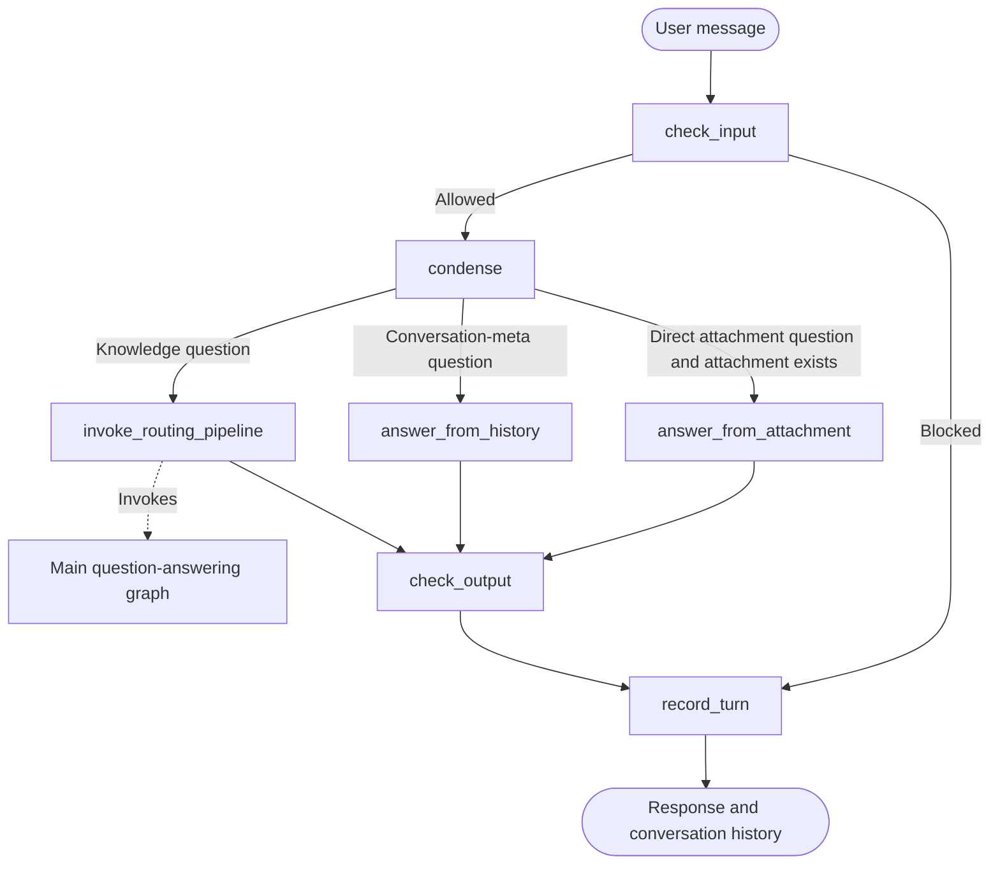
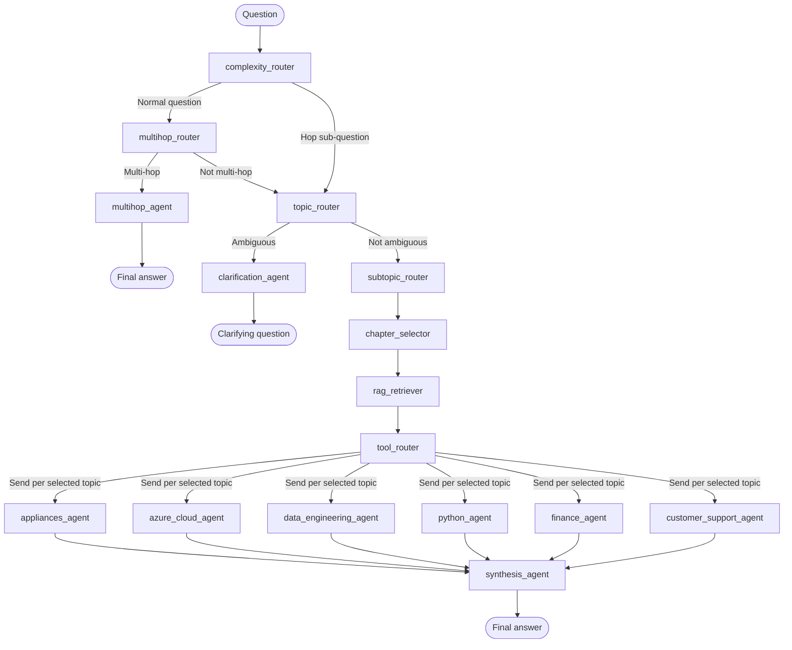

# Routing Lab 3: Agent and Routing Map

This document maps the implemented Lab 3 chat and question-answering
graphs, then compares them with Lab 5. Routers classify or select a path;
specialist agents produce answers. The main graph is the full hybrid
graph, not the separate Architecture A/B comparison experiments.

## 1. Chat entry point

[`app/chat/graph.py`](../../routing_lab3/app/chat/graph.py) wraps the
question-answering graph with conversation context and optional guardrails.

- `condense` uses conversation context to make the latest question
  self-contained. Attachment-direct takes precedence when an attachment is
  present; conversation-meta questions use the transcript; other questions
  go to the main graph.
- Input and output guardrails are disabled by default. A blocked input
  goes straight to `record_turn`, skipping question answering.
- With a checkpointer and stable thread ID, the chat graph can restore
  previous conversation state. Direct attachment answers do not enter
  knowledge-base routing.

## 2. Main question-answering graph

This is the graph assembled in
[`app/graph.py`](../../routing_lab3/app/graph.py).

Only selected topic branches run. For more than one topic, LangGraph
`Send` dispatches the selected specialists in parallel; the diagram does
not imply that every agent answers every question.

| Component | Role |
| --- | --- |
| `complexity_router` | Records simple, intermediate, or complex. The complexity value itself does not choose a different route in the current graph. |
| `multihop_router` / `multihop_agent` | Detect and resolve a two-hop dependency. The agent runs the main graph for each hop in sequence and combines the answers. Hop sub-questions bypass the multi-hop router to prevent recursion. |
| `topic_router` / `clarification_agent` | Select topics and per-topic question text, or ask for clarification when the question is ambiguous. |
| `subtopic_router` / `chapter_selector` | Choose a subtopic and record a chapter decision for each selected topic. |
| `rag_retriever` | Retrieves passages by topic and subtopic; it is not restricted to the chapter selector's single chapter decision. |
| `tool_router` | Optionally selects and executes `calculator`, `sql_query`, or `metadata_lookup` for each topic before the agent answers. |
| Specialist agents | Answer from retrieved passages and any successful tool result. They use shared answer and bounded recovery logic in [`agents/_shared.py`](../../routing_lab3/app/agents/_shared.py). |
| `synthesis_agent` | Passes through one response or uses an LLM to merge multiple specialist responses. |

Recovery is inside the specialist, not a separate graph node: an
insufficient answer or tool failure can trigger one retry with broader
topic retrieval and, for a failed tool, a corrected tool input.

## 3. Specialist mapping

The topic/subtopic taxonomy is in
[`app/config.py`](../../routing_lab3/app/config.py).

| Topic | Subtopics | Graph node | Implementation |
| --- | --- | --- | --- |
| `appliances` | refrigerators, washing_machines, dishwashers | `appliances_agent` | [`appliance_agent.py`](../../routing_lab3/app/agents/appliance_agent.py) |
| `azure_cloud` | networking, compute, security, storage | `azure_cloud_agent` | [`azure_agent.py`](../../routing_lab3/app/agents/azure_agent.py) |
| `data_engineering` | spark, databricks, adf | `data_engineering_agent` | [`data_engineering_agent.py`](../../routing_lab3/app/agents/data_engineering_agent.py) |
| `python` | fundamentals, oop, concurrency | `python_agent` | [`python_agent.py`](../../routing_lab3/app/agents/python_agent.py) |
| `finance` | budgeting, loans, investments | `finance_agent` | [`finance_agent.py`](../../routing_lab3/app/agents/finance_agent.py) |
| `customer_support` | orders, refunds, delivery | `customer_support_agent` | [`customer_support_agent.py`](../../routing_lab3/app/agents/customer_support_agent.py) |

For example, a dishwasher specification question can go to the appliances
agent, while a refund question can go to customer support. A request
covering both can run the two specialists in parallel. Decisions are
model-based rather than guaranteed keyword matches.

## 4. Lab 3 versus Lab 5

The main graph wiring and chat graph wiring are the same in
[`Lab 3`](../../routing_lab3/app/graph.py) and
[`Lab 5`](../../routing_lab5/app/graph.py), and both have the same six
specialist topics, multi-hop handling, tools, recovery, conversation
history, and direct chat attachments. Lab 5 does **not** introduce a
different set of specialist agents.

| Area | Lab 3 | Lab 5 |
| --- | --- | --- |
| Knowledge sources | Uses its curated knowledge-base indexing and retrieval, and supports direct per-chat attachments. | Retains both, and adds a separate uploaded-knowledge ingestion workflow with validation, classification, chunking, indexing, retrieval checks, and publishing. |
| Knowledge management | No `/knowledge/documents` API or Knowledge Base Manager UI. | Adds knowledge-document APIs and a manager UI for uploading, inspecting status and events, and manually correcting classifications for review or failed documents. |
| PDF extraction | Joins extracted pages with a single newline. | Separates extracted pages with blank lines, helping the ingestion chunker retain page boundaries. |
| Topic routing prompt | Treats `SmartHome` among customer-support context signals. | Clarifies that the brand name alone does not imply customer support; the actual question determines the topic. This is prompt guidance, not a guarantee of a particular classification. |
| Conversation condensing | Resolves references from conversation history. | Adds guidance to prefer the most recently discussed compatible subject for ambiguous references. |
| Evaluation and batch reports | Uses substring-based fact scoring and the original batch reporting. | Adds equivalent standalone year-duration matching, source scoring, and custom dataset/output paths in batch reports. |

Lab 5's separate ingestion graph is defined in
[`app/ingestion/graph.py`](../../routing_lab5/app/ingestion/graph.py),
its endpoints in [`app/api/main.py`](../../routing_lab5/app/api/main.py),
and its manager in
[`KnowledgeBaseManager.tsx`](../../routing_lab5/frontend/src/components/KnowledgeBaseManager.tsx).
Published chunks are indexed with topic/subtopic and source metadata so
the existing retriever can supply them to the same specialists. This is
different from answering a question directly from a chat attachment,
which both labs support.

For Lab 5's full diagrams, see
[`routing_lab5-mapping.md`](routing_lab5-mapping.md).
