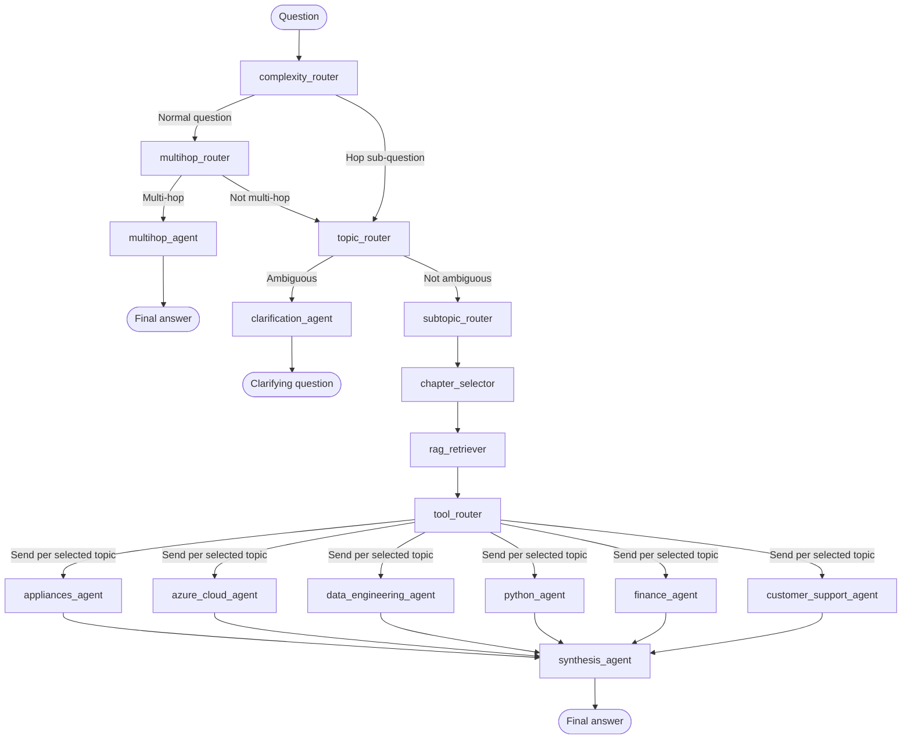
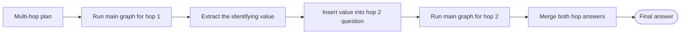
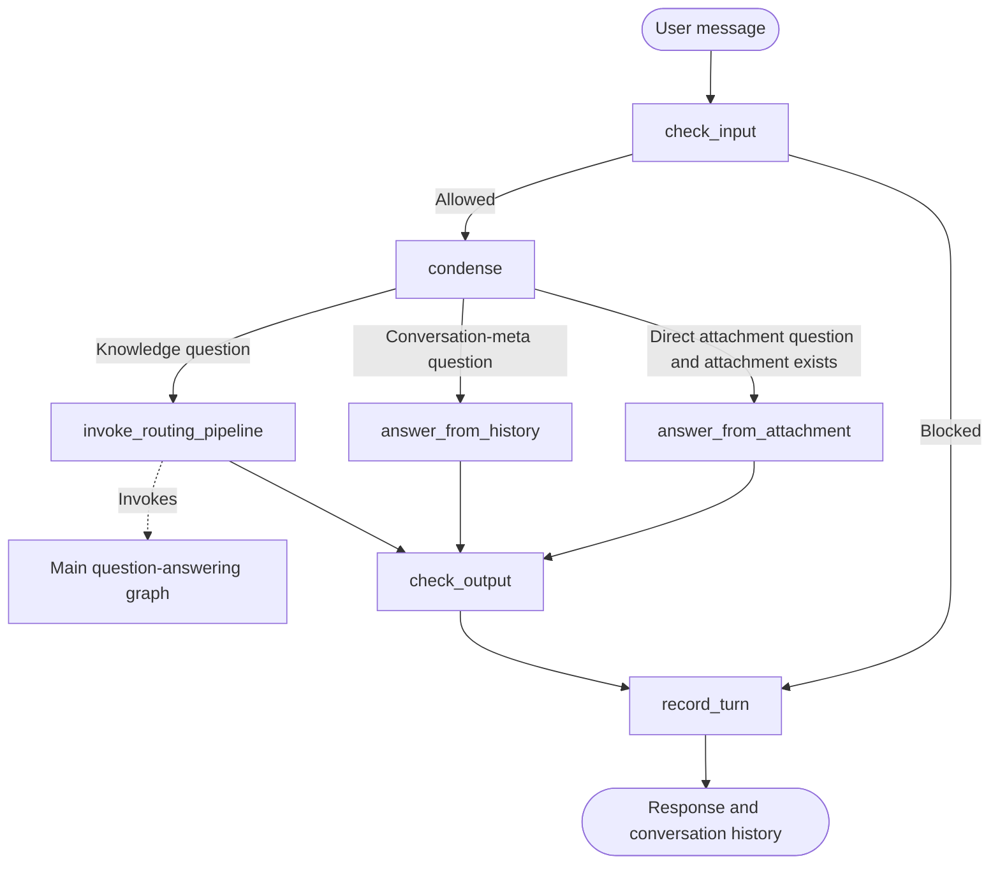
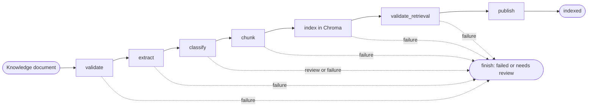

# Routing Lab 5: Agent and Routing Map

This map describes the implemented graphs in `routing_lab5`, not the
experimental Architecture A or B. Routers make decisions; specialist agents
answer questions. The main graph is defined in
[`app/graph.py`](../../routing_lab5/app/graph.py).

## 1. Main question-answering graph

Only the selected specialist branches run. Multiple selected topics are
dispatched in parallel using LangGraph `Send`; the diagram does not mean
every question goes to all six agents.

| Stage | Responsibility |
| --- | --- |
| `complexity_router` | Records simple, intermediate, or complex. The recorded tier itself does not select a different path in the current graph. |
| `multihop_router` | Detects a dependent two-hop question and creates a plan; otherwise routing continues normally. |
| `topic_router` | Selects one or more topics, prepares per-topic question text for multi-topic requests, and flags ambiguity. |
| `clarification_agent` | Asks for clarification and ends the graph when the topic decision is ambiguous. |
| `subtopic_router` | Selects a subtopic for each selected topic. |
| `chapter_selector` | Records a chapter decision for each topic. It does **not** limit retrieval to that one chapter. |
| `rag_retriever` | Retrieves passages per topic and selected subtopic, allowing evidence from multiple chapters. |
| `tool_router` | Decides per topic whether to run `calculator`, `sql_query`, or `metadata_lookup`, and executes the selected tool before the specialist runs. A tool is not required for every question. |
| Specialist agents | Answer their topic's question using retrieved passages and any successful tool result. They share the implementation in [`agents/_shared.py`](../../routing_lab5/app/agents/_shared.py). |
| `synthesis_agent` | Passes through a single specialist response; for multiple topics, uses an LLM to merge the responses. |

`document_search` is not a selectable tool in `tool_router`: retrieval has
already run. The specialist's bounded recovery is internal to the agent,
not another graph node: on insufficient information or a tool error, it
can broaden retrieval to the topic and retry once; a failed tool's input
can also be corrected and retried.

## 2. Topic-to-agent mapping

The topic keys and subtopics are configured in
[`app/config.py`](../../routing_lab5/app/config.py). The mapping from topic
to graph node and implementation is in
[`app/graph.py`](../../routing_lab5/app/graph.py).

| Topic | Subtopics | Graph node | Implementation |
| --- | --- | --- | --- |
| `appliances` | refrigerators, washing_machines, dishwashers | `appliances_agent` | [`appliance_agent.py`](../../routing_lab5/app/agents/appliance_agent.py) |
| `azure_cloud` | networking, compute, security, storage | `azure_cloud_agent` | [`azure_agent.py`](../../routing_lab5/app/agents/azure_agent.py) |
| `data_engineering` | spark, databricks, adf | `data_engineering_agent` | [`data_engineering_agent.py`](../../routing_lab5/app/agents/data_engineering_agent.py) |
| `python` | fundamentals, oop, concurrency | `python_agent` | [`python_agent.py`](../../routing_lab5/app/agents/python_agent.py) |
| `finance` | budgeting, loans, investments | `finance_agent` | [`finance_agent.py`](../../routing_lab5/app/agents/finance_agent.py) |
| `customer_support` | orders, refunds, delivery | `customer_support_agent` | [`customer_support_agent.py`](../../routing_lab5/app/agents/customer_support_agent.py) |

For example, a dishwasher specification question can map to
`appliances` / `dishwashers` / `appliances_agent`; a refund-policy
question can map to `customer_support` / `refunds` /
`customer_support_agent`. Actual selections are model decisions, not
fixed keyword rules.

## 3. Multi-topic versus multi-hop

**Multi-topic:** independent parts of a question can be sent to different
specialists in parallel. For example, a named dishwasher specification
and a refund-policy question can use the appliances and customer-support
branches, followed by `synthesis_agent`.

**Multi-hop:** a later question depends on a value discovered by an
earlier question. For example, "Which washing machine has the largest
capacity, and what is its price?" first needs the model name.

The two sub-invocations set `is_hop_subquestion`, so they bypass the
multi-hop router and cannot recursively create further multi-hop plans.
The top-level multi-hop branch ends after its own synthesis; it does not
continue through the top-level topic router. See
[`multihop_agent.py`](../../routing_lab5/app/agents/multihop_agent.py).

## 4. Chat wrapper

The chat graph wraps the main graph; it does not always invoke it. Its
actual edges are in [`app/chat/graph.py`](../../routing_lab5/app/chat/graph.py).

Condensing produces a self-contained question using the conversation
context. Attachment-direct takes precedence when an attachment exists;
history questions use the transcript, while knowledge questions invoke the
main graph. Input and output guardrails are optional and disabled by
default; a blocked input skips the rest of the answer pipeline. A
checkpointer can restore conversation state for a stable thread ID.

## 5. How uploaded knowledge reaches agents

Knowledge ingestion is a **separate** graph in
[`app/ingestion/graph.py`](../../routing_lab5/app/ingestion/graph.py), not
an agent branch of the question-answering graph:

Published chunks carry topic, subtopic, source filename, and other
provenance metadata. The main graph's retriever can then return those
chunks to the corresponding specialist. A failed retrieval validation
rolls back the newly indexed chunks. A direct chat attachment question,
by contrast, can be answered from the attachment without using the
knowledge-base routing graph.

## Key state and trace

The nodes exchange [`RoutingState`](../../routing_lab5/app/state.py),
including `selected_topics`, `selected_subtopics`, `selected_chapters`,
`retrieved_passages`, `tool_results`, `agent_responses`, and
`final_answer`. Parallel agent responses are merged by topic;
`execution_log` accumulates the routing and agent trace. Multi-hop
results and recovery attempts are recorded separately in the state.
