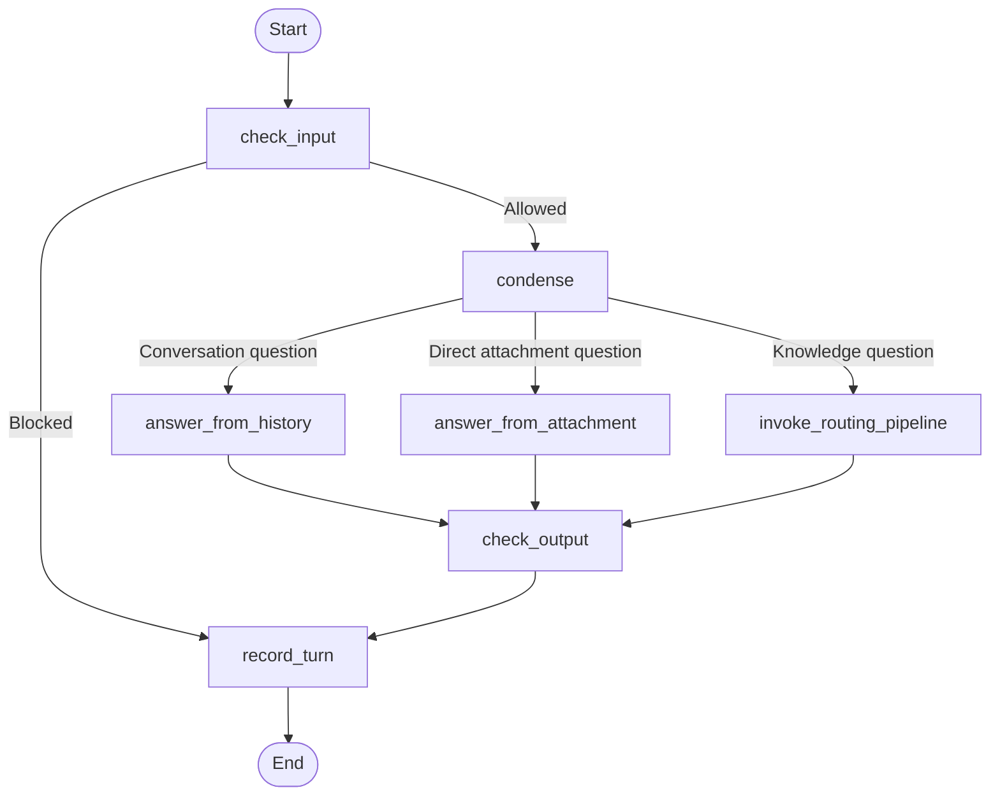
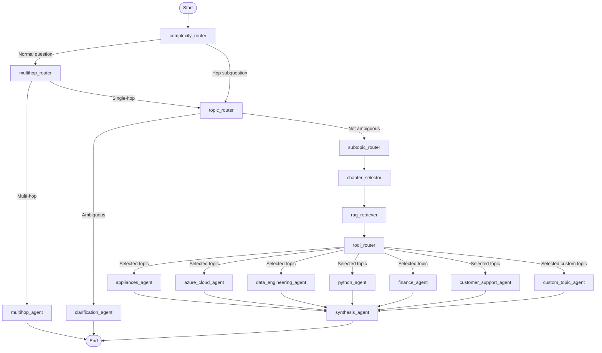
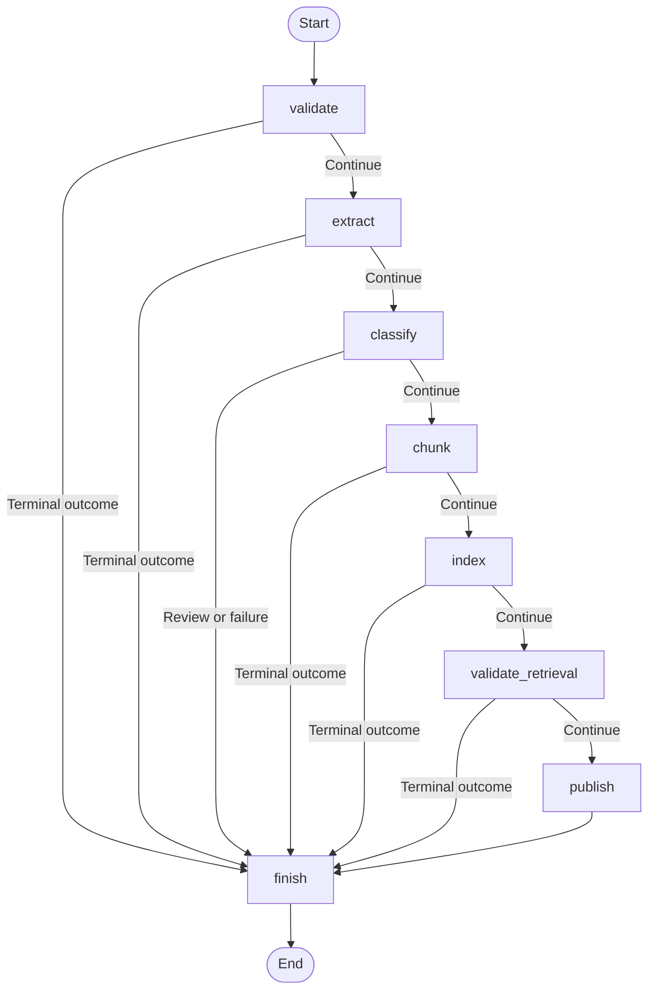

# LangGraph application diagrams

These diagrams show the compiled application workflows in Lab 7's copied
version 6 baseline. Nodes are named after their LangGraph counterparts.
The experimental comparison architectures are not shown.

## Chat workflow

The chat graph handles one conversation turn. A knowledge question invokes
the separate routing graph shown below.

`check_input` and `check_output` are no-ops when guardrails are disabled.
The blocked-input path skips both answer generation and the output check.
When an attachment is present and the question is classified as directly
about it, the attachment path takes precedence over conversation history.

Source: [chat graph](../app/chat/graph.py).

## Knowledge routing workflow

- `tool_router` fans out to one agent per selected topic; multiple agents
  can run in parallel. Tool selection and execution happen inside that node.
- `multihop_agent` invokes the routing graph for each hop, rather than
  following an explicit graph edge back to the start. Hop subquestions skip
  `multihop_router` to prevent nested multi-hop recursion.
- Chapter selection is recorded for inspection; retrieval is scoped by
  topic and subtopic, not limited to the selected chapter.

Sources: [routing graph](../app/graph.py),
[multi-hop agent](../app/agents/multihop_agent.py).

## Document ingestion workflow

Knowledge-base uploads use a separate graph. Each conditional step moves to
`finish` when it has set a terminal outcome; classification may request
review, while other steps can fail.

Source: [ingestion graph](../app/ingestion/graph.py).
